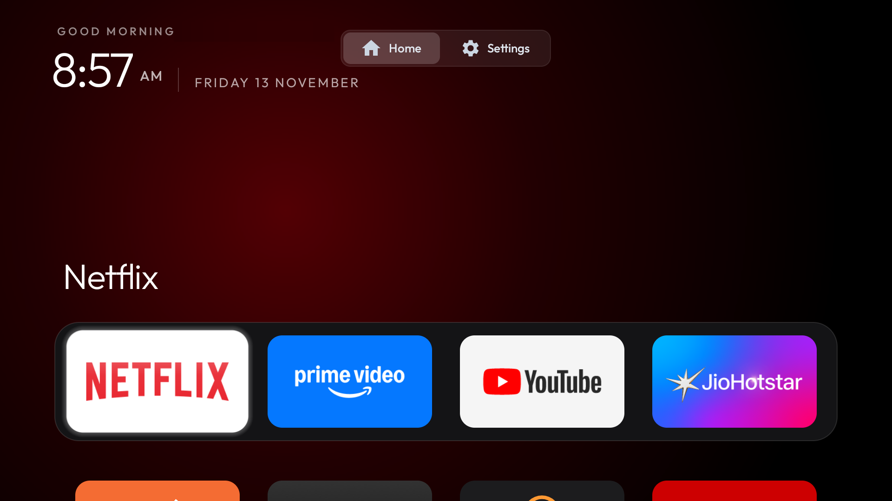
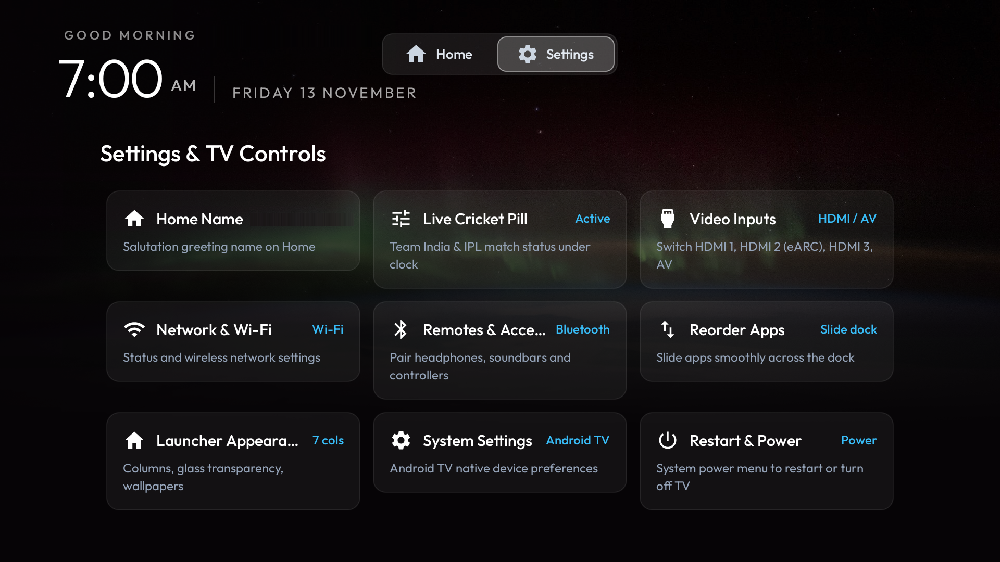
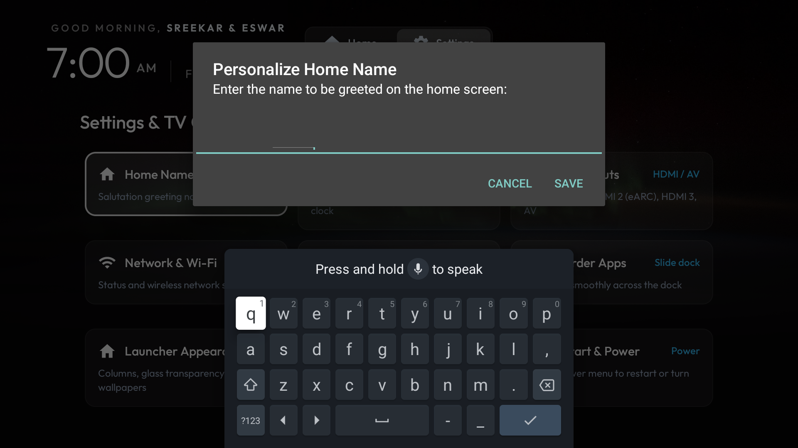
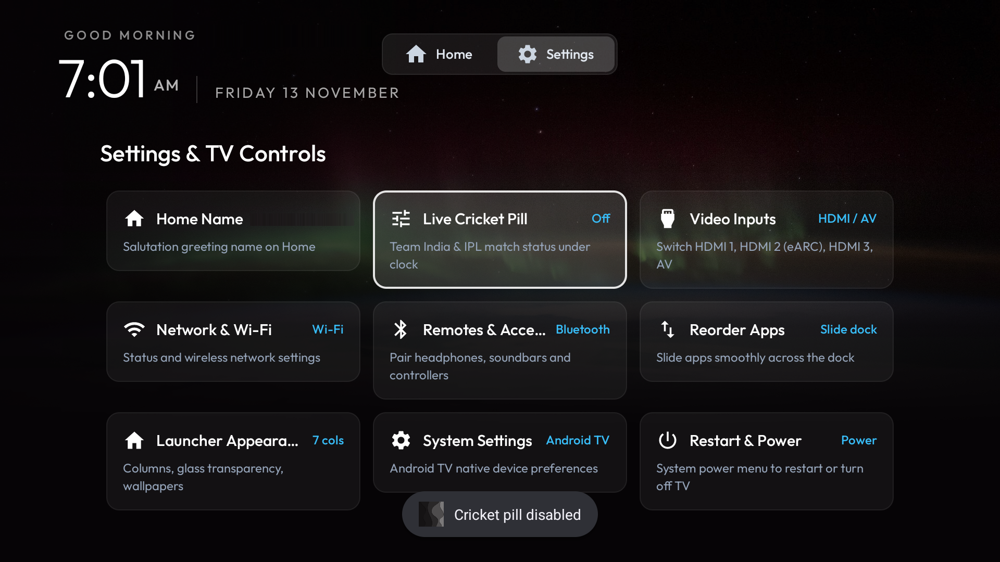
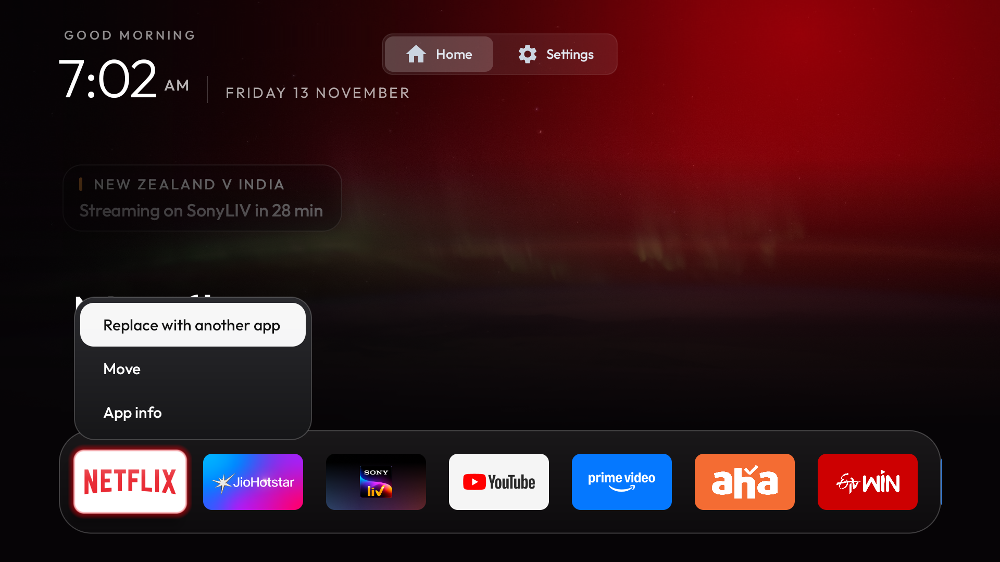

# DebloatYourTV

<p align="center">
  
</p>

<p align="center">
  <strong>The clean, ad-free, high-performance Android TV launcher.</strong><br>
  No ads · No sponsored rows · No tracking · Apple TV-style fluid dock · Zero internet permissions
</p>

<p align="center">
  
  
  
  
</p>

---

## What is DebloatYourTV?

Modern smart TVs are cluttered with sponsored carousels, full-screen autoplay trailers, telemetry trackers, and sluggish OEM skins. **DebloatYourTV** transforms your Android TV or Google TV into a fast, serene, and responsive entertainment center.

- **Zero Ads & Zero Clutter**: No recommendations you didn't ask for. Just your favorite apps in an elegant, curved dock.
- **Privacy by Architecture**: The launcher itself requests **zero internet permissions**. It cannot phone home, log telemetry, or push advertisements.
- **Apple TV-Style Fluidity**: Spring-physics animated glass highlight, ambient glow matching the active app artwork, and 60fps responsiveness.
- **Centered 2-Tab Navigation**: Clean, distraction-free header featuring `Home` and a dedicated `Settings` Hub.
- **Personalized Salutation**: Dynamic time-of-day greeting customized with your household name.
- **Smooth "Lift & Carry" App Reordering**: Elevate and slide apps across the dock with fluid neighbor animations and an intuitive floating HUD.

---

## Visual Tour (Version 1.0)

### 1. Serene Home Screen
Your pinned favorites, time-of-day salutation, clock, and live cricket scores cleanly presented.
<p align="center">
  
</p>

### 2. Dedicated Settings Hub
A clean 3×3 card grid housing every essential TV control in one convenient place:
<p align="center">
  
</p>

### 3. Personalize Household Name
Set your name directly with an on-screen dialog to receive customized greetings (*Good morning, Good evening*):
<p align="center">
  
</p>

### 4. Single Live Cricket Pill Toggle
Enable or disable live sports countdowns and match tracking under the clock with one click:
<p align="center">
  
</p>

### 5. Quick Tile Menu & Smooth Reordering
Hold OK on any tile to replace, view info, or slide apps smoothly with animated elevation:
<p align="center">
  
</p>

---

## Quick Start: Installing on Your TV

No root or cables required. All you need is your TV and a computer on the same Wi-Fi network.

### Step 1: Enable USB Debugging on Your TV
1. On your TV, navigate to **Settings** → **Device Preferences** → **About**.
2. Scroll to **Build** and click the OK/Center button **7 times** until it displays *"You are now a developer!"*.
3. Go back one level to **Device Preferences** → **Developer Options**.
4. Enable **USB debugging**.

### Step 2: Find Your TV's IP Address
Go to **Settings** → **Network & Internet** → Select your connected Wi-Fi network → Note down the IP address (e.g. `192.168.0.104`).

### Step 3: Connect and Install

#### Option A: Using the Included Python ADB Tool (Recommended - No ADB Setup Needed)
From your computer terminal inside this repository:
```bash
# 1. Test connection to your TV
TV_HOST=192.168.0.104 ./tools/venv/bin/python3 tools/tv.py "echo TV_CONNECTED"

# 2. Build and install the launcher
cd launcher
./build-and-install.sh
```

#### Option B: Using Standard ADB
If you already have Android platform tools installed:
```bash
# 1. Connect to TV
adb connect 192.168.0.104:5555

# 2. Build release APK
cd launcher
./gradlew assembleRelease

# 3. Install APK
adb install -r app/build/outputs/apk/release/app-release.apk

# 4. Set DebloatYourTV as the default Home launcher
adb shell cmd package set-home-activity --user 0 com.debloatyourtv.launcher/.MainActivity
```

Press the **Home** button on your remote. Your TV will now launch into **DebloatYourTV**!

---

## Optional: Disable Manufacturer OEM Bloatware

To prevent sluggish background OEM apps from running and taking up memory, you can disable manufacturer bloatware safely via ADB (nothing is deleted; apps can be re-enabled at any time):

```bash
# Xiaomi / PatchWall TVs:
adb shell pm disable-user --user 0 com.mitv.tvhome
adb shell pm disable-user --user 0 com.xiaomi.mitv.upgrade
adb shell pm disable-user --user 0 com.xiaomi.mitv.advertise
```

*(See `docs/devices/` for model-specific debloat lists).*

---

## How to Restore Back to Stock

If you ever wish to return to your TV's original stock launcher:
```bash
# Re-enable the stock launcher (example for Google TV)
adb shell pm enable com.google.android.tvlauncher

# Reset default Home activity
adb shell cmd package set-home-activity --user 0 com.google.android.tvlauncher/.MainActivity
```

---

## Technical Specifications & Architecture

| Feature | Specification |
| :--- | :--- |
| **Package ID** | `com.debloatyourtv.launcher` |
| **Minimum Android Version** | Android 8.0 (API 26) |
| **Target SDK** | Android 14 (API 34) |
| **APK Footprint** | ~550 KB (R8 minified and resource-shrunk) |
| **Memory Footprint (RAM)** | ~18 MB steady state |
| **Network Access** | **None** (`android.permission.INTERNET` omitted) |
| **D-Pad Navigation** | DPAD_UP to Home/Settings tabs · DPAD_DOWN to dock · Hold OK for tile menu |

---

## License

This project is licensed under the [MIT License](LICENSE).
